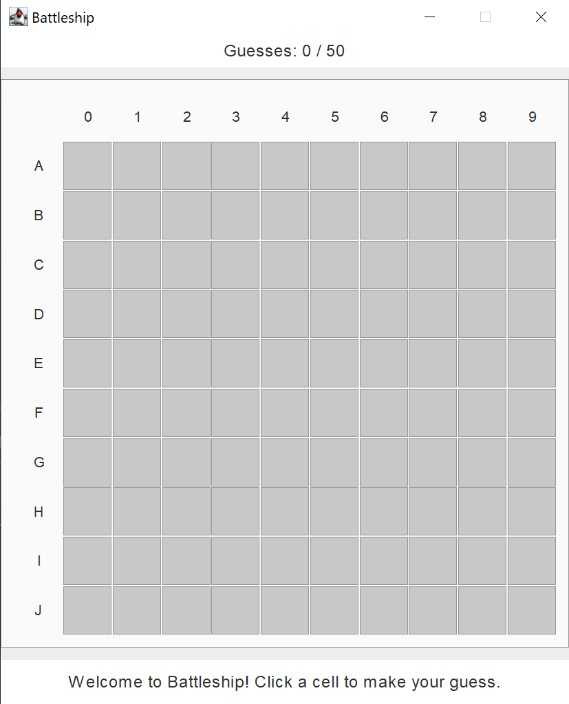
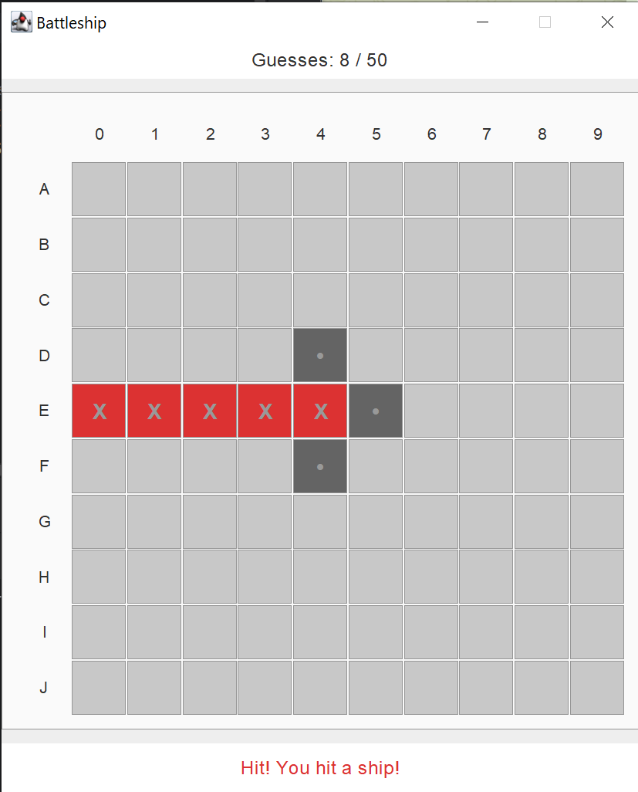

# Battleship

Single-player Battleship in Java. Five ships are hidden on a 10×10 grid, and you have 50 shots to sink them all.

The same game runs with two different interfaces, a console one and a Swing window. I built it to practice MVC: the game logic is written once, and only the view and controller change.

| Console | Swing |
|:---:|:---:|
|  |  |
|  |  |

## How it works

- **Model** (`BattleshipModel`) places the ships, checks every shot, counts guesses, and decides when the game is over. It doesn't know which interface is used.
- **View** shows the grid and messages. There are two: `BattleshipConsoleView` prints text, `SwingBattleshipView` draws a window of buttons.
- **Controller** connects them. There are two, because input arrives differently.

**Console** (`BattleshipConsoleController`): a loop that runs until the game is over.

1. Ask for a guess and read a line, like `A5`.
2. Turn it into coordinates (`A5` is row 0, column 5) and call `model.makeGuess(0, 5)`.
3. Show HIT or MISS, the guess count, and the updated grid.
4. When the game ends, show win or lose and reveal where the ships were.

**Swing** (`SwingBattleshipController`): no loop. Each click on a cell runs once.

1. The clicked button tells the controller its row and column.
2. The controller calls `model.makeGuess(row, col)`.
3. The controller redraws the grid and the message.

Both controllers use the same model, unchanged.

## Requirements

- **JDK 17 or newer**
- **JUnit 5 and Mockito** for tests, already in `libs/`

## Run

In PowerShell, from the project folder:

```powershell
javac -d bin (Get-ChildItem -Recurse src/main -Filter *.java).FullName
```

Console version:

```powershell
java -cp bin ConsoleApp
```

Swing version:

```powershell
java -cp bin SwingApp
```

## Playing

Ships: Aircraft Carrier (5), Battleship (4), Submarine (3), Destroyer (3), Patrol Boat (2). They're placed randomly and never touch each other, not even diagonally.

In the console, type a cell like `A5` or `j9`. Rows are A–J, columns are 0–9. `H` marks a hit, `M` a miss. `K5`, `A10`, and a cell you already shot are rejected.

In Swing, click a cell. Red with X is a hit, dark grey with a dot is a miss.

You win when every ship is sunk. You lose after 50 shots.

## Tests

Compile first:

```powershell
javac -d bin -cp "libs/*" (Get-ChildItem -Recurse src -Filter *.java).FullName
```

All tests:

```powershell
$cp = "bin;" + ((Get-ChildItem libs -Filter *.jar).FullName -join ";")
java -XX:+EnableDynamicAgentLoading -jar libs/junit-platform-console-standalone-1.11.4.jar execute -cp $cp --scan-classpath
```

One test:

```powershell
java -XX:+EnableDynamicAgentLoading -jar libs/junit-platform-console-standalone-1.11.4.jar execute -cp $cp --select-method battleship.model.BattleshipModelPlacementTest#startGame_shouldPlaceShipsCorrectly
```

The console controller is tested twice, once with hand-written mocks and once with Mockito, to compare the two approaches.

## Code

```
src/main/java/
  ConsoleApp.java       starts the console version
  SwingApp.java         starts the Swing version
  battleship/model/     game logic, ship types, cell states
  battleship/view/      console view and Swing view
  battleship/controller/  console controller (loop) and Swing controller (clicks)
src/test/java/battleship/
  model/                placement, shots, game over, full games
  controller/           console controller with manual mocks and with Mockito
libs/                   JUnit and Mockito jars
```
